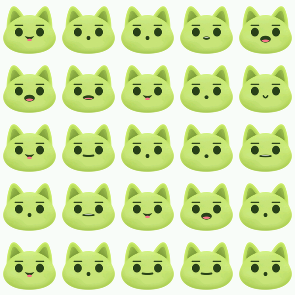

# buddyos-stem-display-firmware

ESP-IDF firmware for the **screen-equipped BuddyOS STEM device**: the kit that shows the
Buddy a child designed on the website, drawn with LVGL and animated from the child's own
keyframes.

It is planned in `../buddyos-stem-features-management`:

- [Kid-designed Buddy faces on a device screen](../buddyos-stem-features-management/docs/features/kid-designed-faces-on-device-screen.md)
- [Kid-authored face motion](../buddyos-stem-features-management/docs/features/kid-authored-face-motion.md)
- [ADR 0009 — the face catalogue ships as its own updatable partition](../buddyos-stem-features-management/docs/adr/0009-face-catalogue-as-updatable-partition.md)
- [ADR 0010 — motion is keyframes over targets](../buddyos-stem-features-management/docs/adr/0010-face-motion-as-keyframes-over-catalogue-layers.md)

## What this repo is for

1. **Panel bring-up** — driver, LVGL, a frame on the glass.
2. **The face renderer** — composite catalogue sprites into a face from a few hundred bytes
   of the child's choices. Never pixels over the wire; part ids and colours.
3. **The `.buddy` motion interpreter** — walk keyframe tracks, drive `lv_anim`. The format
   is defined in `../buddyos-stem-fe/src/data/motion.ts`, and its behaviour is pinned by
   `src/data/motion.fixtures.json` there. **Those fixtures are the contract**: this firmware
   is correct when it reproduces them, including the per-easing LUT checksums.
4. **The catalogue partition** — artwork delivered and updated without a firmware release,
   over the download-and-verify path the vision model already proves.
5. **Lip-sync** — the mouth follows the audio the Buddy is speaking, never its text. See
   **Lip-sync** below.

## What this repo is *not*

**It is not `../buddyos-stem-c-firmware`.** That repo is the on-device *vision* spike —
camera, TFLite Micro, esp-nn — deliberately narrow, and it stays that way. This device type
**does not carry the offline image model**, which is the entire premise of the faces spec:
the vision stack is 259 KB of a 1,449 KB app image, and the memory it frees is what makes a
screen affordable at all.

Read that repo for two things only, and do not change it:
- its **measurements** — what a device without the vision stack gets back;
- its **model loader**, the precedent for download-and-verify (presigned URL → streamed to
  flash → CRC checked before commit).

## Building

Dependencies are **vendored in `components/`** and the component manager is switched off.
idf 5.2.2's resolver cannot parse a `&&` in a dependency manifest and fails while merely
*listing* registry versions, so pinning cannot avoid it — but nothing here needs the
registry:

    docker run --rm -e IDF_COMPONENT_MANAGER=0 -v "$PWD":/fw -w /fw \
        espressif/idf:v5.2.2 idf.py -DIDF_TARGET=esp32s3 build

`components/lvgl` is a shallow clone of LVGL 9.2 (cloned by `sim/build.sh` on first run,
shared by both builds). `components/esp_lcd_gc9a01` is copied from esp-bsp with its two
esp-bsp cmake-helper lines commented out and the version triple supplied directly.

The panel driver glue is written here rather than pulled from `esp_lvgl_port`: a display,
two DMA-capable partial buffers, a flush that waits on the panel's completion callback,
and a tick from `esp_timer`. About sixty lines, and one fewer dependency.

## Watching it without hardware

`sim/` builds the same `face_view.c` / `face_motion.c` / `face_assets.c` for the host and
renders them into a memory buffer. See **Simulator** below.

## Status

**It runs on a panel.** First hardware bring-up 2026-09-27: an ESP32-S3-WROOM-1-N8R2
(8 MB flash, 2 MB embedded PSRAM, chip rev v0.2) driving a GC9A01 240×240 round module over
SPI at 40 MHz. The Buddy appears, in the child's colours, and cycles idle → listening →
thinking → speaking with the mouth following the embedded speech clip.

Pins as wired on that bench board: **SCK 14, MOSI 10, DC 11, CS 12, RST 13**, no backlight
line. (The newbiely tutorial this started from uses 11/12/1/13/14; the board in hand wins.)

### What only hardware found

Three things, none of which the simulator could have caught — worth stating, because the
simulator is otherwise so good that it is tempting to trust it further than it goes:

- **A reset loop on the very first boot.** `mem_report("boot")` asks LVGL for a heap
  monitor *before* `lv_init()`, and LVGL 9.2 walks an empty pool list, leaves `total_size`
  at 0 and divides by it. The simulator only ever reports after init, so it never asked the
  question at a moment when the answer was fatal.
- **Every colour wrong.** LVGL stores RGB565 low byte first; the panel clocks the high byte
  first. The face was pixel-perfect in shape and cyan-green with purple contour bands. The
  simulator renders into host memory and displays from host memory, so the two endiannesses
  cancel and it has always looked right. Confirmed *before* touching the board by applying
  the same swap to a simulator frame and matching it against the photograph.
- **The lip-sync classifier cost 134% of a core.** See below.

### Lip-sync on silicon

| | µs of CPU per frame | per 16 ms of audio |
| --- | --- | --- |
| First measurement | 21,433 | **134%** of a core |
| After the ring buffer | 1,777–1,865 | **~11%** of a core |

The first version slid its analysis window with a 511-sample `memmove` for **every arriving
sample** — 16 MB/s of copying to advance an audio pointer. A ring buffer walked once per hop
does the same arithmetic in the same order, so the conformance golden did not move: still
149 of 149 frames.

Both figures are at **160 MHz with `-Og`**, which is the pessimistic case twice over: the
part runs at 240 MHz and this is a debug build. Nothing here needed either knob, which is
the point of quoting them.

### Static sizes

As of 2026-09-26, ESP32-S3 with Wi-Fi and MQTT linked in, PSRAM enabled:

| | face only | with Wi-Fi + MQTT | + lip-sync |
| --- | --- | --- | --- |
| Static IRAM | 68,582 B | 94,566 B (26.1%) | 94,566 B |
| Static D/IRAM | 46,808 B | 68,512 B (19.8%, **277,344 B free**) | 75,736 B (21.9%, **270,120 B free**) |
| App image | 669,673 B | 1,332,841 B (of a 2 MB partition) | 1,432,989 B |

The lip-sync column is the demo build (`CONFIG_BUDDY_LIPSYNC_DEMO`), so its flash figure
carries 76,800 B of embedded speech that a product build would not. What the classifier
itself costs is **2,094 B of code and 7,204 B of RAM** — three 512-float arrays and the
sample window, static rather than heap so the cost is visible here instead of arriving
during a call. Halving `FRAME` would halve the RAM and the arithmetic; it would also halve
the frequency resolution, which is what separates /i/ from /u/, so it is not free.

RAM cost of the radio, by archive: `libpp` 13,942 B, `libnet80211` 11,997 B, `liblwip`
3,721 B, `libesp_wifi` 862 B, `libmbedtls` 266 B, `libmqtt` 0 B (all flash).

### Runtime, from the board

The figure the planning docs kept asking for, measured 2026-09-27:

| Stage | Internal free | min-ever | largest block | PSRAM free |
| --- | --- | --- | --- | --- |
| boot | 283,919 | 283,919 | 188,416 | 2,094,528 |
| face up | 259,167 | 259,167 | 163,840 | 2,094,244 |
| wifi init | 176,563 | 176,563 | 81,920 | 2,033,072 |
| wifi started | 176,327 | 174,523 | 81,920 | 2,031,500 |
| wifi connected | 175,939 | 174,523 | 81,920 | 2,030,596 |
| mqtt started | 166,667 | 166,667 | 69,632 | 2,029,964 |
| mqtt connected | 171,711 | 166,135 | 69,632 | 2,029,764 |

…the same run over **TLS** to a public test broker, and then to **the product's own EMQX**
with a device JWT:

| Stage | Internal free | min-ever | largest block |
| --- | --- | --- | --- |
| mqtt connected, TLS (mosquitto) | 137,863 | 130,175 | 36,864 |
| **mqtt connected, TLS + JWT (EMQX)** | **129,895** | **126,459** | **32,768** |

The real broker costs ~8 KB more than the test one — a 4 KB client buffer for the token, the
token itself, and a longer client id — and that is the configuration the product will ship,
so **32,768 B is the largest contiguous internal block a feature can actually ask for.**

LVGL's own heap: **6,744 B used of 31,112, peak 6,744, 1% fragmented** with the face up —
against the 13,320 B the simulator predicted, so the 32 KB pool has room to spare.

**The whole face costs 24,752 B of internal SRAM at runtime**, almost all of it the two DMA
draw buffers. Bringing the radio up costs another ~82,700 B and, more importantly, **halves
the largest contiguous block** from 163,840 to 81,920 B — which is the number to watch,
because it is contiguity rather than total free that kills a DMA allocation.

### It reaches the product broker

`mqtts://mqtt-sg.buddyos.ai:1883` — EMQX, with the device JWT as the password — accepted
this firmware on 2026-09-27, and the token's ACL allowed both topics it needs:

    net: TLS: verifying against the embedded Amazon Root CA 1
    net: connecting as buddyos-stem-staging-ESP32-sim-b17712ac (token 1267 B)
    net: mqtt connected
    net: subscribed: staging/stem/device/ESP32-sim-b17712ac/directive
    net: published  staging/stem/device/ESP32-sim-b17712ac/event

Connecting only proves the token was accepted; the subscribe and the publish prove the ACL
*inside* it allows what the device actually needs, which is a separate question and the one
that bites later. Both are done on connect, so a bad token is visible in the log rather than
at the first directive.

The client follows `../buddyos-stem-c-firmware/components/stem_mqtt` rather than inventing a
second way to reach the same broker. Three details are carried over because each is a silent
failure otherwise:

- **`buffer.size = 4096`.** The device JWT is ~1.3 KB, so the default 1 KB buffer cannot
  hold the CONNECT this client sends. The symptom is a broker that appears to hang up.
- **One root, not the bundle.** The broker sits behind an AWS certificate, so
  `certs/AmazonRootCA1.pem` is embedded: **6 KB of flash against the bundle's 66 KB**, and it
  verifies rather than skipping. `CONFIG_BUDDY_MQTT_AWS_ROOT=n` switches back to the bundle
  for a broker with some other publicly-trusted certificate.
- **Topic namespace must match the token's `environment` claim.** Topics are
  `{env}/stem/device/{username}/…` and the ACL names them literally; a mismatch is denied,
  not misrouted.

Credentials live in `sdkconfig`, which is gitignored. Nothing in this repo carries a token.

### What TLS costs, which is the number to carry forward

A connected plaintext broker leaves 171,711 B free with a 69,632 B largest block. The same
broker over TLS leaves **137,863 B** free with a **36,864 B** largest block, and the
low-water mark through the handshake is **130,175 B** — so a single MQTT TLS session costs
about **36 KB at its worst moment** and, more to the point, **halves the largest contiguous
block a second time**:

    largest contiguous internal block
    boot            188,416
    face up         163,840
    radio up         81,920
    mqtt (plain)     69,632
    mqtt (TLS)       36,864
    EMQX + JWT       32,768   <- what the product actually runs

Total free is not the thing that will break. Contiguity is: this product line has twice been
bitten by it, and once it lied about the cause — *a starved handshake reported itself as
`NOT_TRUSTED`*, sending the reader after certificates. **esp-webrtc's DTLS-SRTP would be a
second TLS context on top of this one**, and it would be asking for large blocks from what
is left of a 36 KB ceiling. That is the question the voice work has to answer, and it now
has a floor to answer it from.

TLS also costs **65,813 B of flash** (1,499,397 B image against 1,433,584 B) and 424 B of
static D/IRAM, almost all of it the certificate bundle.

Measured against `test.mosquitto.org:8886` — the listener with a publicly-trusted
certificate; 8883 is signed by mosquitto's own CA, which the bundled roots do not contain.
That broker drops an idle connection after about a minute (`transport_read(): EOF`), which
is the broker's policy and not a fault here.

## Taking the measurement

    idf.py menuconfig          # BuddyOS display firmware -> SSID, password, broker
    idf.py -p /dev/ttyUSB0 flash monitor

`sdkconfig` is gitignored, so credentials set there stay on the bench. On macOS the
container cannot see the serial port: build in Docker, then flash from the host
(`python3 -m venv venv && venv/bin/pip install esptool`) with the command `idf.py build`
prints. A `mqtts://` broker URI switches on certificate verification against IDF's bundled
public roots; nothing else needs changing.

Every milestone logs one `mem` line — `boot`, `face up`, `wifi init`, `wifi started`,
`wifi connected`, `mqtt started`, `mqtt connected`, then `running` periodically:

    I (mem) [mqtt connected] internal: free N, min-ever N, largest N | dma: free N, largest N
    I (mem) [mqtt connected] psram:    free N, min-ever N
    I (mem) [mqtt connected] lvgl:     used N of N, peak N, frag N%

**`min-ever` is the figure that matters** — the low-water mark, not whatever happens to be
free when you look. And `largest` next to a healthy `free` is how fragmentation announces
itself before an allocation fails. With no SSID configured the Wi-Fi stack still comes up
and reports; it simply does not associate, which is itself a useful baseline.

Worth running twice, with `CONFIG_SPIRAM_TRY_ALLOCATE_WIFI_LWIP` on and off: on is the
answer for this board, off is the pessimistic case and tells you how much of the margin is
really PSRAM's doing.

## Lip-sync

The mouth shape comes from **the audio, never the text**. This product speaks Vietnamese
and English and switches between them inside a sentence; text would mean grapheme-to-
phoneme rules per language, while a vowel's formants are the same in either and a
fricative is noise in both. `main/face_lipsync.c` is a transcription of
`../buddyos-stem-fe/src/data/visemes.ts`, and the thresholds are **generated** into
`main/generated/face_assets.c` by the baker rather than copied — the same discipline as the
easing table.

Two rules in that file carry most of the weight, and both were learned the expensive way:

- **Loudness is relative.** Every persona has a cloned voice at whatever level the child
  recorded, so a fixed gate leaves one Buddy mute and another chewing on room noise.
- **A fricative is noise, not brightness.** "Energy above 4 kHz" fires on half of a bright
  voice's vowels. Zero-crossing rate and spectral flatness ask the right question.

`face_view_set_live_mouth()` overrides **the mouth only** — brows, eyes and the head keep
the motion the child authored, so a Buddy that blinks and tilts while it talks goes on
doing both.

Feed it the PCM on its way to the speaker, never the microphone. A device with both would
otherwise lip-sync to the room, and to itself.

### Holding it to the website's answer

    docker run --rm -v "$PWD":/fw -w /fw espressif/idf:v5.2.2 bash tools/xcheck.sh

Two generated goldens, both emitted by `tools/bake_face.ts` from the front end's own
TypeScript: `xcheck.txt` for motion sampling, `lipsync-xcheck.txt` for the classifier over
`tools/lipsync-fixture.pcm` — 2.4 s of real Omnivoice speech, Vietnamese then English in
one utterance, because code-switching is the case the design exists for. The C is fed in
173-sample chunks that divide neither the frame nor the hop, since the decoder will not
hand over tidy buffers either.

Currently **149 of 149 frames agree**. If the two sides ever diverge, the same face
lip-syncs differently in the studio and on the kit, and a child is the one who finds it.

Those are simulator frames, 96 ms apart, through the fixture. Rendering them is not
decoration: an earlier bug had two classes drawing the *same* mouth, which every number in
the harness called healthy and only a picture showed.

### What is not measured

**CPU.** A 512-point FFT and a spectral flatness every 16 ms of audio is the one part of
this that could plausibly not fit, and it has never run on silicon. The demo build logs
`lip-sync: N us per frame` every hundred frames — that line is the measurement, and it
needs a panel and a board to exist.

## Simulator

    docker run --rm -p 8080:8080 -v "$PWD":/fw -w /fw espressif/idf:v5.2.2 \
        bash sim/build.sh --serve

Then open <http://localhost:8080/>. It uses the container's *host* gcc, not the Xtensa
toolchain, so none of the IDF-version trouble applies. LVGL is cached as a static library
after the first build. Without `--serve` it writes one PPM per sampled moment instead —
`docs/sim-states.png` is made that way.

It plays `tools/lipsync-fixture.pcm` through the classifier while the face is in its
speaking state, with the audio clock tied to the sim clock — so a paused frame shows a real
mouth shape for a real instant of speech. `FACE_PCM=<file>` plays something else.

It runs the same two partial draw buffers `main.c` gives the device, and reports what a
face costs: draw buffers, LVGL heap used and peak, fragmentation, and the sprite bytes
that live in flash rather than RAM. What it cannot see: the internal-versus-PSRAM split,
DMA-capable memory, a 240 MHz Xtensa doing the blending, and the radio taking cycles.

## Open questions blocking real work

- ~~**Which panel?**~~ **Answered 2026-09-27**: GC9A01 240×240 round on SPI at 40 MHz, on
  the bench and drawing. The draw buffers and `partitions.csv` sizing are no longer
  provisional for this module. A *production* panel may still differ, and the one open
  request stands: **bring the backlight out to a GPIO**, which this module does not have.
- ~~**Which SoC and how much flash?**~~ **Answered on the bench**: ESP32-S3-WROOM-1-N8R2,
  8 MB flash, 2 MB embedded PSRAM — the module the hardware doc already named as the current
  choice. The 8 MB partition table is no longer a placeholder. Whether *2 MB* of PSRAM is
  enough is a voice question, not a face one, and is still open.
- **IDF version.** Pinned to v5.2.2 to match the org's existing Docker workflow. Note the
  v5.5 problem in `../buddyos-stem-c-firmware` was an I²C `driver_ng` conflict caused by the
  *camera* driver, which this firmware does not have — so that constraint is inherited by
  convention here, not by necessity.
